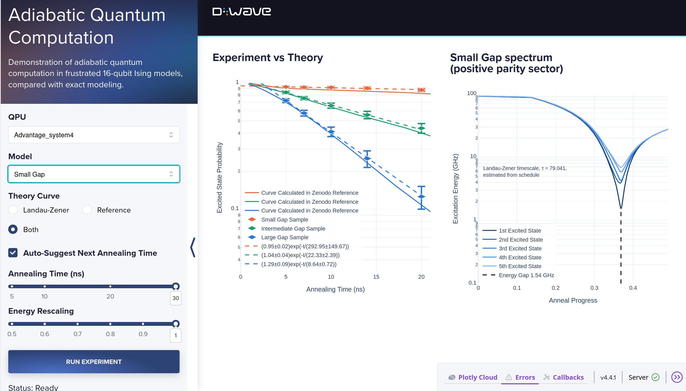

[](
  https://codespaces.new/dwave-examples/adiabatic-quantum-computation?quickstart=1)

# Adiabatic Quantum Computation with Landau-Zener Scaling

A demonstration of using the
[fast-anneal protocol](https://docs.dwavequantum.com/en/latest/quantum_research/annealing.html)
on a quantum computer to find the ground states of frustrated 16-variable Ising
models, in the regime described by
[adiabatic quantum computation](https://en.wikipedia.org/wiki/Adiabatic_quantum_computation).

This example employs quantum annealing in the coherent regime of a D-Wave
quantum processing unit (QPU), producing ground states at a rate aligned with
theoretical predictions: in particular, gap-dependent scaling based upon the
[Landau-Zener formula](https://en.wikipedia.org/wiki/Landau%E2%80%93Zener_formula).

This demo complements the
[Kibble-Zurek demo](https://github.com/dwave-examples/kibble-zurek), which
demonstrates statistical properties in the regime with high rates of excitation
away from the ground state.



* [Installation](#Installation)
* [Usage](#Usage)
* [Adiabatic Quantum Computation](#Adiabatic-Quantum-Computation)
* [Model Overview](#Model-Overview)
* [Code](#Code)
* [References](#References)
* [License](#License)

## <a name="Installation"></a> Installation

You can run this example without installation in cloud-based IDEs that support
the [Development Containers Specification](https://containers.dev/supporting)
(aka "devcontainers") such as GitHub Codespaces.

For development environments that do not support `devcontainers`, install
requirements:

```bash
pip install -r requirements.txt
```

If you are cloning the repo to your local system, working in a
[virtual environment](https://docs.python.org/3/library/venv.html) is
recommended.

## <a name="Usage"></a> Usage

Your development environment should be configured to access the
[Leap&trade; quantum cloud service](https://docs.dwavequantum.com/en/latest/ocean/sapi_access_basic.html).
You can see information about supported IDEs and authorizing access to your Leap
account
[here](https://docs.dwavequantum.com/en/latest/ocean/leap_authorization.html).

Run the following terminal command to start the Dash application:

```bash
python app.py
```

Access the user interface with your browser at http://127.0.0.1:8050/.

The demo program opens an interface where you can configure problems and submit
these problems to a solver.

Configuration options can be found in the [demo_configs.py](demo_configs.py)
file.

> [!NOTE]\
> If you plan on editing any files while the application is running, please run
the application with the `--debug` command-line argument for live reloads and
easier debugging: `python app.py --debug`

## <a name="Adiabatic-Quantum-Computation"></a> Adiabatic Quantum Computation
Adiabatic quantum computation is a canonical theoretical model of quantum
computation. In its simplest formulation, a system is prepared in the ground
state of a driver. The driver term is then slowly scaled to zero while a problem
Hamiltonian is scaled up. Adiabatic evolution guarantees that with sufficient
isolation from the environment, and Hamiltonian evolution at a sufficiently
small rate, the system evolves to the ground state of the problem Hamiltonian.

In D-Wave quantum annealers, a transverse-field driver is combined with a
diagonal problem Hamiltonian. The problem Hamiltonian can be programmed so that
its ground state encodes the solution to an optimization problem.

For many optimization problems, the spectrum of the Hamiltonian as it evolves
from driver-dominated to problem-dominated exhibits a well-defined closing gap
(or anti-crossing). As evolution proceeds through the phase described by a
closing gap, diabatic transitions out of the ground state to an excited state
are possible. When the success probability (the probability of ending in a
ground state) is limited by transitions from the ground state to the first
excited state at a single anti-crossing, a two-state Landau-Zener process
describes the rate of excitation, which becomes exponentially small as the
annealing time increases.

## <a name="Model-Overview"></a> Model Overview

As the annealing time increases, we anticipate a decreasing rate of excitation.
Asymptotically this is expected to follow an exponential decay, with the
decay rate determined by spectral gap properties.

### Experiment

The problem Hamiltonians studied are 16-qubit, 52-coupler frustrated Ising
models with uniform (antiferromagnetic and ferromagnetic) absolute coupling
strength matched to those presented in Figure 2c [[1]](#1). These are stored in
[static/models](static/models) as JSON files and can be selected from the
*Model* dropdown, they are matched to those in the Zenodo repository supporting
the publication [[2]](#2).

The problem Hamiltonian can be scaled up or down to modify the gap properties,
using the *Energy Rescaling* slider. The evolution time is controlled by the
*Annealing Time* slider.

The problem is small enough that it can be parallelized across several disjoint
processor locations. Data is collected from a single programming of 400 reads
per data point. Error bars show the standard deviation across embeddings,
treating each embedding as an independent estimator (errors reflect a
combination of control error and sampling error).

### Theoretical models

#### The energy spectrum
The evolution of the driver term and problem Hamiltonians is modeled using
device-specific annealing schedules. The spectrum is calculated via exact
diagonalization on the basis of the programmed Hamiltonian and schedule. As demo
parameters are adjusted, it is recalculated. The schedule files are
limited-accuracy approximations to the energy scales (see documentation); this
feeds forward to some uncertainty in other derived quantities.

Parity is a conserved quantity of the evolution, therefore the
eigenvalues are restricted to the positive parity sector. Parity
might be violated by open-system effects and control errors, but
the spectral gap analysis restricted to the given sector proves
accurate. The parity operator is a product of Pauli-X operators,
with eigenvalue 1.

#### The schedule-based Landau-Zener approximation
A Landau-Zener timescale τ[model] can be calculated based on a QPU-specific
spectrum derived from a matched schedule file for each model, using a linear
approximation to the rate through the gap. This value (when the schedule file
exists) is shown in the right plot. The Landau-Zener approximation is accurate
if a single gap closes tightly, the anneal duration is long, and closed system
dynamics apply.

#### Landau-Zener data fit (default setting)
Once two or more data points are collected they are fitted to a two-parameter
model A_f exp(-t/τ[fit]). Good agreement with Landau-Zener theory is indicated
by approach to a straight line on the log-linear scale for larger time. A small
deviation of A_f from 1 is anticipated, to accommodate non-Landau-Zener
processes. τ[fit] captures the rate of excitation from the ground state, and is
expected to be in qualitative agreement with the schedule derived values
τ[model]. Fitted values are given in legend entries.

#### Literature reference curves (optional setting)
The data from Figure 2c is also included as a reference [[1]](#1). Note that
this data is publicly available as part of a Zenodo repository [[2]](#2). This
theory curve reflects an Advantage system and gives reasonable agreement with
current Advantage systems at full rescaling. The curve is shifted by energy-time
rescaling [[3]](#3), to reflect the variation of energy scales, which are
significantly improved in Advantage2 relative to Advantage systems (yielding
correspondingly lower excitation rates).


## <a name="Code"></a> Code Overview

Most of the code specific to the experiment is in the [src](src) directory. The
remaining files support the user interface, following the standard
[Dash demo template](https://github.com/dwave-examples/template-dash).

*   [src/model_loading.py](src/model_loading.py) loads a problem Hamiltonian
    (``h``, ``J`` and its ground-state energy) from
    [static/models](static/models), along with the precomputed energy spectrum
    and theory curve for that model.

*   [src/process_embeddings.py](src/process_embeddings.py) finds as many
    disjoint minor-embeddings of the 16-qubit problem as fit on the selected
    QPU, so every read samples all embeddings in parallel. Embeddings are cached
    in the [embeddings](embeddings) directory and reused while they remain valid
    for that QPU.

*   [src/plotting.py](src/plotting.py) builds the two figures: excited-state
    probability against annealing time with the theory curves for comparison,
    and the energy spectrum of the selected model with its minimum gap marked.

*   [demo_callbacks.py](demo_callbacks.py) submits each run with
    ``ParallelEmbeddingComposite`` using the fast-anneal protocol, and records
    the fraction of reads that did not reach the ground-state energy.

## References

<a name="1">[1]</a> King, A.D., Suzuki, S., Raymond, J. et al.
Coherent quantum annealing in a programmable 2,000 qubit Ising chain.
Nat. Phys. 18, 1324–1328 (2022). https://doi.org/10.1038/s41567-022-01741-6

<a name="2">[2]</a> King, A.D., Suzuki, S., Raymond, J. et al.
Coherent quantum annealing in a programmable 2000-qubit Ising chain [Data set].
Zenodo (2022). https://doi.org/10.5281/zenodo.7640778

<a name="3">[3]</a> Raymond, J., Amin, M.H., King, A.D. et al.
Quantum error mitigation in quantum annealing.
npj Quantum Inf. 11, 38 (2025). https://doi.org/10.1038/s41534-025-00977-3

## License

Released under the Apache License 2.0. See [LICENSE](LICENSE) file.
